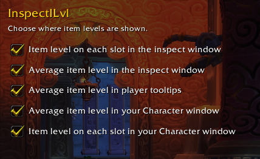

# InspectILvl

**For MoP 5.4.8 (original client, build 18414, e.g. TwinStar). Not for MoP Classic!**

[Report an issue](https://github.com/dmandeveloper/InspectILvl/issues) · [Submit a pull request](https://github.com/dmandeveloper/InspectILvl/pulls)

A small World of Warcraft addon for **Mists of Pandaria 5.4.8** (build 18414, e.g. TwinStar) that shows item level when you inspect or hover other players, and on your own Character window. Written for the original 5.4.x client API, not MoP Classic.

## Screenshots

## Features

- **Per-slot item level** on every gear slot of the inspect window, coloured by item quality.
- **Average item level** under the player's name in the inspect window.
- **Average item level** as a line in player tooltips (your own tooltip uses the game's value; others are inspected in the background).
- **Average item level** in your own Character window.
- Optionally, **per-slot item level** in your own Character window.

## Options

Open **Interface → AddOns → InspectILvl**. Changes apply immediately, and **Defaults** resets everything.

| Option | Default |
| --- | --- |
| Item level on each slot in the inspect window | On |
| Average item level in the inspect window | On |
| Average item level in player tooltips | On |
| Average item level in your Character window | On |
| Item level on each slot in your Character window | **Off** |

Item levels are read from the item tooltip, so upgrade bonuses (e.g. Valor upgrades) are included. The average uses the game's rule: 16 slots, shirt and tabard excluded, and a two-handed or ranged weapon with an empty off-hand counts twice. The result is rounded to a whole number like the default UI.

## Install

Download the zip from the [latest release](https://github.com/dmandeveloper/InspectILvl/releases/latest) and extract the `InspectILvl` folder into `<WoW>/Interface/AddOns/` (or copy it from this repo). The folder must be named `InspectILvl`. Then restart the client; a `/reload` is not enough the first time, because the addon declares a saved variable.

## Slash commands

- `/iilvl` — self-check: prints this addon's average for your own gear next to the game's `GetAverageItemLevel()`.
- `/iilvl weapons` — debug: prints the weapon types, item levels and whether a main hand is counted twice for the player in the inspect window (or your target), plus the computed average.

## Notes

- Only players you can inspect (same faction, within inspect range) get a tooltip level.
- The addon never targets, focuses or acts on a unit. For tooltips it asks the server to inspect the player under your mouse, so it waits until you have hovered for 0.3s, stays within inspect range, skips inspects while the inspect window is open, rate-limits itself to one every 1.5s, and never clears inspect data that another addon or you started.
- The tooltip value only appears after a short inspect (about a second, after you have hovered the player for 0.3s). A read is only trusted when the target has at least 8 equipped slots and two consecutive reads agree, since gear data can arrive in pieces.

## License

MIT, see [LICENSE](LICENSE).
