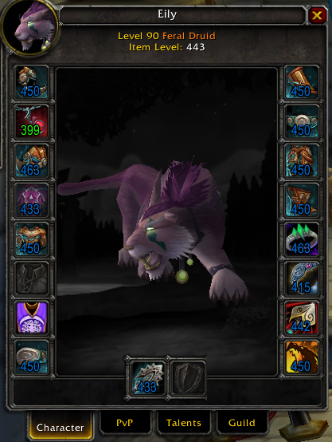
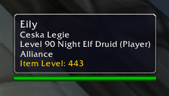

# InspectILvl

**For MoP 5.4.8 (original client, build 18414, e.g. TwinStar). Not for MoP Classic!**

[Report an issue](https://github.com/dmandeveloper/InspectILvl/issues) · [Submit a pull request](https://github.com/dmandeveloper/InspectILvl/pulls)

A small World of Warcraft addon for **Mists of Pandaria 5.4.8** (build 18414, e.g. TwinStar) that shows item level when you inspect or hover other players. Written for the original 5.4.x client API, not MoP Classic.

## Screenshots

## Features

- **Per-slot item level** on every gear slot of the inspect window, coloured by item quality.
- **Average item level** under the player's name in the inspect window.
- **Average item level** as a line in player tooltips (your own tooltip uses the game's value; others are inspected in the background).
- Each of the three can be switched on or off in **Interface → AddOns → InspectILvl**.

Item levels are read from the item tooltip, so upgrade bonuses (e.g. Valor upgrades) are included. The average uses the game's rule: 16 slots, shirt and tabard excluded, and a two-handed or ranged weapon with an empty off-hand counts twice. The result is rounded to a whole number like the default UI.

## Install

Download the zip from the [latest release](https://github.com/dmandeveloper/InspectILvl/releases/latest) and extract the `InspectILvl` folder into `<WoW>/Interface/AddOns/` (or copy it from this repo). The folder must be named `InspectILvl`, then restart the client (a `/reload` is not enough the first time, because the addon declares a saved variable).

## Slash commands

- `/iilvl` — self-check: prints this addon's average for your own gear next to the game's `GetAverageItemLevel()`.

## Notes

- The tooltip value only appears after a short inspect (about a second). A read is only trusted when the target has at least 8 equipped slots and two consecutive reads agree, since gear data can arrive in pieces.

## License

MIT, see [LICENSE](LICENSE).
